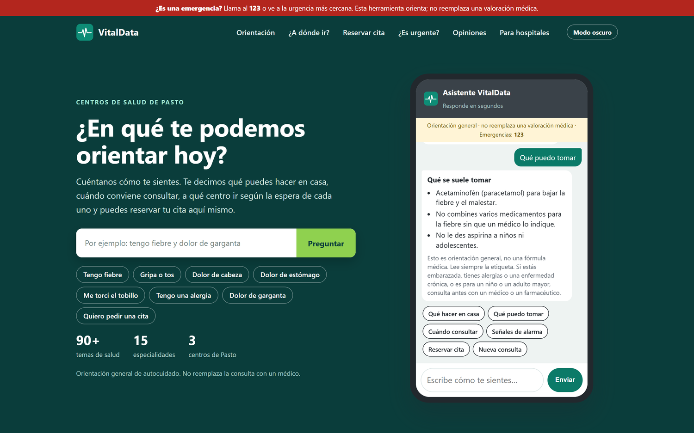
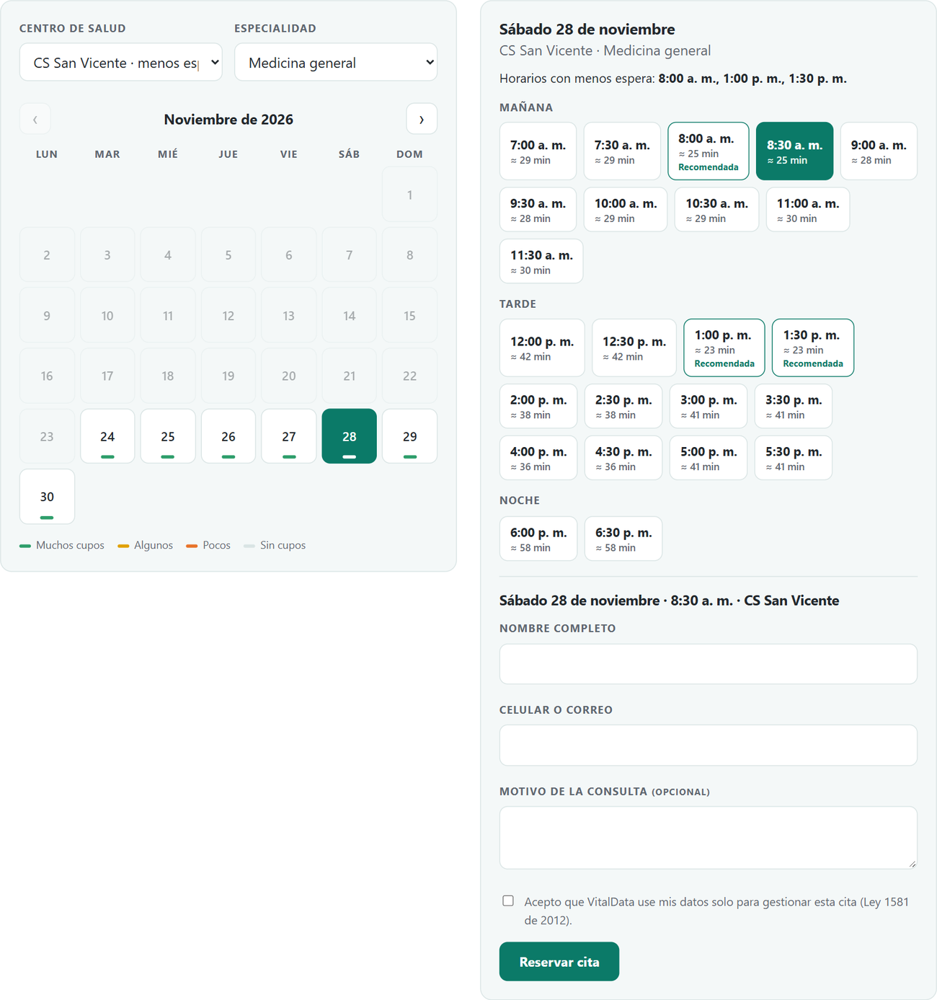
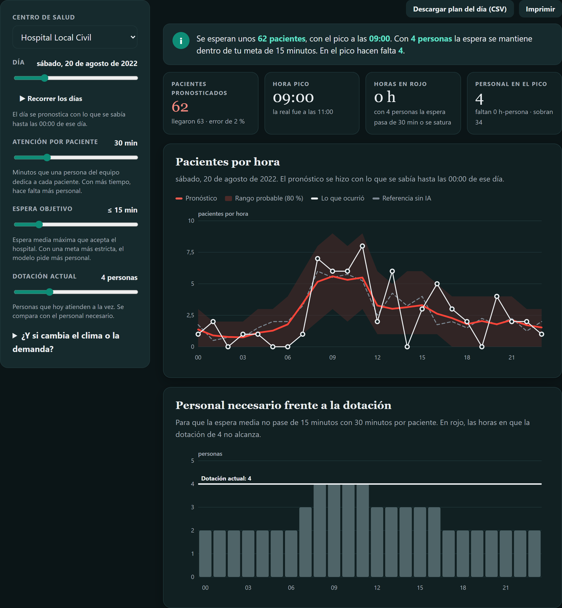
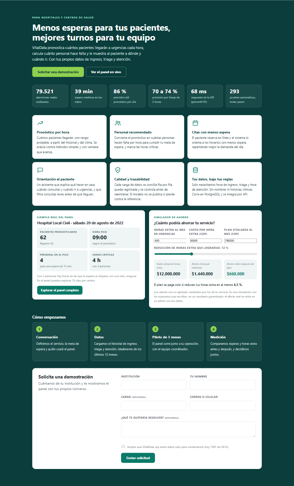
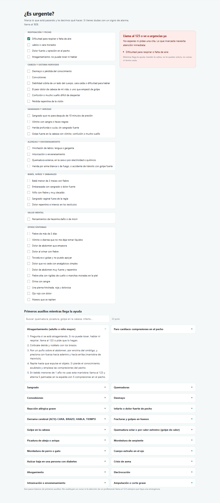

# VitalData

Pronóstico de llegadas a urgencias, personal recomendado y orientación al paciente, construido con datos abiertos reales de tres centros de salud de Pasto.

Proyecto de Data Thinking, Universidad Autónoma de Occidente, 2026. Lo hicimos Sebastian Lozano y Julian David Cuellar.



## Qué hace

Las urgencias se planean por turnos, pero la gente llega por horas. Con las atenciones reales de la E.S.E. Pasto Salud y el clima del IDEAM hicimos dos productos:

1. **Sitio para pacientes** (`/`). Tiene seis partes, sin gráficas:
   - **Asistente.** El paciente escribe cómo se siente y responde: qué hacer en casa, qué medicamentos de venta libre se suelen usar (sin dosis ni fórmula) y cuándo consultar. Cubre más de 60 temas de 15 especialidades (síntomas comunes, pediatría, ginecología, dermatología, ortopedia, salud mental, enfermedades crónicas, dengue y más). Si detecta una señal de alarma, como dolor de pecho, dice que llame al 123 y no compara centros. Si no conoce un tema, lo dice y ofrece reservar con un profesional.
   - **¿A dónde te conviene ir?** Por día y hora, con la franja del día (mañana, tarde, noche), muestra qué centro suele tener menos espera, con esperas reales de 2022.
   - **Reserva de citas.** Calendario por mes con cupos y disponibilidad, horarios de 30 minutos con la espera típica de cada uno (marca los tres con menos espera), código para consultar o cancelar, archivo `.ics` para el calendario del celular y cupos limitados garantizados por un índice único en la base.
   - **¿Es urgente?** Verificador de signos de alarma que dice si llamar al 123 o pedir una cita hoy, y primeros auxilios paso a paso.
   - **Preguntas** frecuentes y una caja para preguntarle al asistente.
   - **Opiniones** que escriben los usuarios, con promedio y distribución. Empiezan vacías: no hay opiniones inventadas.
   - **Para hospitales.** Cifras reales del sistema, vista previa del panel con datos reales, simulador de ahorro con los supuestos del hospital, camino de implementación y formulario de solicitud de demostración (se guarda en `vd.solicitud_demo`).

   El asistente cubre más de 90 temas de salud, 13 familias de medicamentos de uso común (sin dosis: si se las piden, lo rechaza), 9 trámites del sector (triage, derechos, documentos, exámenes, chequeos), responde preguntas sobre los datos del sistema con cifras reales, entiende preguntas de seguimiento y tolera errores de escritura.

   Son reglas de orientación, no un diagnóstico, y siempre lo avisa. Las agendas son del propio VitalData: en un piloto se conectarían con la agenda del hospital.
2. **Panel para hospitales** (`/panel.html`). Para quien coordina urgencias: elige un centro y un día y ve cuántos pacientes se pronosticaron hora por hora (con rango probable), cuántos llegaron de verdad y cuántas personas hacían falta para cumplir su meta de espera. Puede cambiar los minutos por paciente, la dotación y probar escenarios de lluvia, temperatura y demanda, y descargar el plan del día en CSV. Incluye también el análisis de la demanda: cuando llegan más pacientes en una hora, la espera sube (correlación de Spearman entre 0,23 y 0,37, con prueba de permutación), y los casos de triage IV y V esperan una mediana de 79 a 82 minutos, frente a 37 en triage III.

## Así se ve

| Reserva de citas | Panel para hospitales |
| --- | --- |
|  |  |

| Sección para hospitales | ¿Es urgente? y primeros auxilios |
| --- | --- |
|  |  |

## Cómo correrlo

Necesitamos Docker Desktop, Python 3.12 o superior y Git.

```bash
git clone https://github.com/jslozanod/VitalData.git
cd VitalData
cp .env.example .env          # cambia las dos contraseñas
docker compose up -d db       # PostgreSQL 16
```

Cargamos los datos y entrenamos los modelos (la primera vez baja unas 89 mil filas de datos.gov.co):

```bash
python -m venv .venv && source .venv/bin/activate     # en Windows: .venv\Scripts\activate
pip install -r requirements-dev.txt
export PYTHONPATH=src
python scripts/correr_etl.py --init --triage --clima
python scripts/publicar_modelos.py
```

Y levantamos la aplicación:

```bash
docker compose up -d --build api   # la página y la API en http://localhost:8000
```

- Sitio para pacientes: http://localhost:8000
- Panel para hospitales: http://localhost:8000/panel.html
- Documentación de la API (Swagger): http://localhost:8000/docs
- Documentación técnica con las evidencias: http://localhost:8000/proyecto.html

Si no hay API en marcha, la página abre igual con una copia exportada de los mismos datos (`web/data/snapshot.js`), pero los escenarios con clima necesitan la API.

### Airflow

```bash
docker compose up -d airflow-web airflow-scheduler
```

Interfaz en http://localhost:8080 (usuario `admin`, la contraseña es la de `AIRFLOW_ADMIN_PASSWORD` en tu `.env`). El flujo `vitaldata_diario` corre todos los días a las 5:00 y también se puede lanzar a mano:

`verificar_fuente → [cargar_triage, cargar_clima] → controles_de_calidad → entrenar_y_publicar → compuerta_del_modelo → exportar_snapshot`

Cada tarea reintenta dos veces con espera creciente. La carga se frena si no concilia y el modelo no se publica si pierde contra la referencia.

## Los datos

| Fuente | Qué usamos | Identificador |
| --- | --- | --- |
| E.S.E. Pasto Salud, datos.gov.co | Clasificación en triage de urgencias, 89.453 filas, 2020 a 2022 | `vt5n-eu2r` |
| IDEAM, datos.gov.co | Precipitación (cada 10 minutos) de la estación 0052045080, Pasto | `s54a-sgyg` |
| IDEAM, datos.gov.co | Temperatura de la misma estación | `sbwg-7ju4` |
| SECOP II y TRM, datos.gov.co | Precios de proveedores y tasa de cambio del modelo financiero | ver `docs/` |

La carga concilia: 89.453 filas bajadas − 9.932 duplicadas − 0 rechazadas = 79.521 en la base. El diccionario de datos está en [docs/diccionario_datos.md](docs/diccionario_datos.md).

Dos cosas de los datos nos obligaron a decidir cosas del modelo. La fuente no trae registros entre abril de 2020 y marzo de 2021, así que entrenamos solo desde abril de 2021. Y desde mayo de 2022 las llegadas casi se duplican, así que el modelo usa el nivel de la última semana y no un promedio de toda la historia.

## El modelo y qué tan bien funciona

Regresión de Poisson por hora con el perfil del tipo de día, el nivel de los últimos 7 días válidos, lluvia y temperatura. El personal se calcula con teoría de colas (Erlang C) para una espera objetivo que define quien usa la herramienta.

Lo evaluamos con ventana que avanza: cada semana se reentrena solo con lo que ya había pasado. Los parámetros se eligieron en una ventana de validación y los 53 días de prueba (8 de agosto al 29 de septiembre de 2022) no se usaron para escoger nada. Lo comparamos con tres referencias sin IA y calculamos intervalos por bootstrap. Resultados (precisión = 1 − WAPE):

| Centro | Franja de 3 h, VitalData | Mejor referencia | Mejora (IC 95 %) | Por día, VitalData |
| --- | --- | --- | --- | --- |
| Centro Hospital La Rosa | 73,6 % | 70,3 % | +3,4 puntos (2,0 a 5,0) | 87,3 % |
| CS San Vicente | 71,0 % | 68,4 % | +2,6 puntos (0,5 a 5,0) | 86,0 % |
| Hospital Local Civil | 70,3 % | 69,1 % | +1,2 puntos (−0,6 a 2,9) | 85,4 % |

Lo decimos como es:

- El modelo le gana a las referencias por franja de 3 horas en los tres centros, pero la mejora es modesta y solo es estadísticamente clara en dos.
- Por día no hay diferencia con la media de 4 semanas.
- La meta que nos pusimos, 85 % por franja de 3 horas, **no se cumple** (estamos entre 70 y 74 %). Por día sí se alcanza.
- El rango probable del 80 % cubre entre 87 y 90 % de las horas de prueba.
- Agregar el clima casi no cambia la precisión (la diferencia con y sin clima es de décimas).

## Arquitectura

```
datos.gov.co → ETL → PostgreSQL 16 → modelos → FastAPI → aplicación web
                  ↑ orquesta Airflow (7 tareas)     ↑ pytest (293 pruebas)
```

Los diagramas completos (flujo de datos, modelo entidad-relación, despliegue) y la tabla de decisiones están en [docs/arquitectura/README.md](docs/arquitectura/README.md).

```
src/vitaldata/
  etl/       extraer, validar, cargar, tareas de Airflow
  db/        schema.sql (esquema en estrella, restricciones, índices)
  models/    pronóstico, referencias, backtest, colas, espera real
  api/       FastAPI, esquemas Pydantic, servicio, asistente, base de orientación (conocimiento.py y conocimiento_extra.py) y reservas (reservas.py)
  export.py  copia estática de los datos para la página
airflow/dags/vitaldata_diario.py
web/         sitio para pacientes (index.html), panel para hospitales (panel.html) y documentación técnica (proyecto.html)
tests/       unitarias, de límites y de integración
scripts/     correr_etl, publicar_modelos, evidencias, analizar_usabilidad
docs/        diccionario, arquitectura, evidencias, protocolo de usabilidad
```

## Pruebas y evidencias

```bash
PYTHONPATH=src pytest tests -q               # 293 pruebas
python scripts/evidencias.py pruebas         # actualiza el conteo y la cobertura
```

- 293 pruebas pasan; la cobertura es de 89,1 %. Hay pruebas unitarias (validación, modelo, colas, asistente), de límites (entradas inválidas de la API, fechas fuera de rango) y de integración contra PostgreSQL real, con una base aparte (`vitaldata_test`) para no tocar los datos.
- Una verificación cruzada compara el ajuste de scikit-learn con el de statsmodels.
- La API responde con un percentil 95 de 68 ms en 240 peticiones (`docs/evidencias/benchmark.json`).
- El índice por centro y fecha hace la consulta del modelo 5,6 veces más rápida (`docs/evidencias/consultas.json`, con `EXPLAIN ANALYZE`).
- Corrida completa del flujo en Airflow: 7 tareas en `success` en 9 minutos (`docs/evidencias/airflow.json` y la captura en `docs/evidencias/capturas/`).

## Pruebas con personas

La prueba de usabilidad se hace dentro de la misma página (sección "Danos tu opinión" de la documentación técnica): cinco tareas, tiempo y cuestionario SUS, guardado de forma anónima. El protocolo está en [docs/usabilidad/protocolo.md](docs/usabilidad/protocolo.md), y los resultados se calculan solos con las respuestas reales en `/api/usabilidad/resumen`. Nuestra meta es un SUS de 68 o más con cinco personas o más.

Para sacar un reporte con intervalos de confianza: `python scripts/analizar_usabilidad.py`.

## Límites

- Los datos son de Pasto, de 2020 a 2022. Es un sistema real, pero no es el de un hospital cliente de hoy.
- La fuente no trae el personal por turno, por eso el personal se recomienda con una meta de espera y no con una calibración.
- El clima que usa el pronóstico es el observado; en producción vendría de un pronóstico externo y la precisión sería algo menor.
- El asistente del paciente son reglas, no un sistema clínico.

## Costos

El modelo financiero (precios de proveedores consultados el 9 de noviembre de 2026) da un costo fijo de $901.237 al mes, un costo variable de $270.016 por cliente y el punto de equilibrio en dos clientes con el plan Completo de $0,78 millones al mes.

## Licencias y datos

Los datos son abiertos y vienen de datos.gov.co. El código es de nuestro equipo y lo entregamos con fines académicos.
