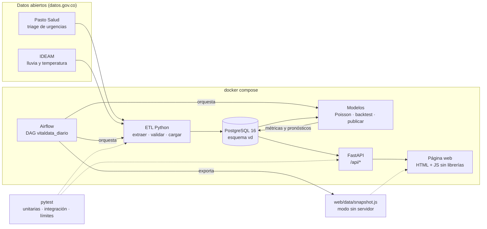
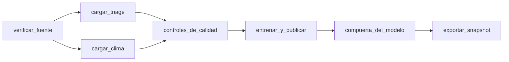
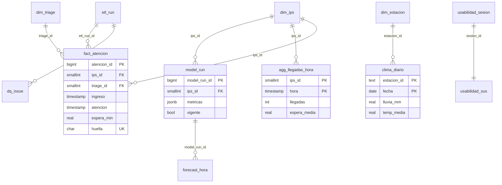

# Arquitectura

Estos diagramas se ven directamente en GitHub (Mermaid). La versión interactiva está en la sección 7 de la página (`web/index.html`).

## Visión general

## Flujo diario (Airflow)

Cada tarea reintenta dos veces con espera creciente. `controles_de_calidad` detiene el flujo si la tabla de hechos no coincide con el agregado, si hay una atención anterior a su ingreso o si hay huellas repetidas. `compuerta_del_modelo` detiene la publicación si el modelo no le gana a la mejor referencia en al menos la mitad de los centros.

## Modelo de datos

## Decisiones y por qué

| Decisión | Por qué | Alternativa que descartamos |
|---|---|---|
| Datos reales de Pasto Salud en vez de simulados | Es el mismo tipo de dato que tendría un hospital cliente (ingreso, triage, atención) y cualquiera puede comprobarlo | Seguir con datos simulados: no demuestra nada sobre el mundo real |
| Poisson por hora con perfil por tipo de día | Las llegadas por hora son conteos pequeños; Poisson los modela directo y da rangos | Redes neuronales o Prophet: con 2-3 llegadas por hora no ganan y no se pueden explicar |
| Nivel de la última semana como variable | En mayo de 2022 las llegadas casi se duplicaron; un promedio de toda la historia habría fallado | Reentrenar solo cada mes |
| Validación con ventana que avanza | Es la forma honesta de medir un pronóstico: nunca se entrena con el futuro | Partir los datos al azar (mezcla pasado y futuro) |
| Referencias sin IA obligatorias | Si no las supera, el modelo no sirve | Reportar solo la precisión del modelo |
| Erlang C para el personal | Es el modelo estándar de colas y se explica en una frase | Calibrarlo con los datos: no traen el personal por turno |
| Carga idempotente por huella md5 | Correr el ETL dos veces no duplica | Truncar y recargar siempre |
| Restricciones en la base | Un error de limpieza no puede dejar datos imposibles | Confiar solo en el código |
| Página sin librerías y con modo sin servidor | Funciona sin internet y abierta desde el disco | Un framework de gráficos |
